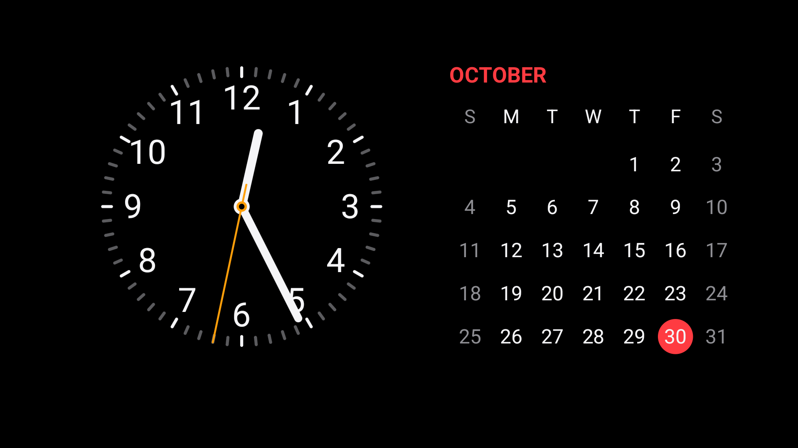

# 横屏

一个无需第三方运行时库的 Android 横屏待机界面，提供指针时钟、月历和自定义背景图片。



待机页采用黑底双栏布局：左侧白色指针表盘与橙色秒针，右侧周日开头的中文月历、红色月份和当天圆点，周末显示灰色。日历区域左右滑动切换月份，点击月份回到本月。时间随设备实时更新，滑动选择的月份不会被时钟刷新重置。

设置页采用深色界面，选择照片后显示缩略图，可点击缩略图更换照片。照片背景铺满屏幕，时钟与日历单独避开刘海区域。

日历背景可选关闭、毛玻璃或液态玻璃。毛玻璃柔化实际背景照片，液态玻璃采用更轻的模糊、边缘折射与高光。日历面板增加了四周留白，月份、星期和日期使用加粗字重；日历文字会随照片明暗切换深浅色，当天红色圆点上的日期保持白色。背景模糊在加载照片或重建页面时生成并缓存，不随时钟每秒重新计算。

## 安装与使用

1. 在 [Releases](https://github.com/xiaozixiaobei/hengping/releases) 下载最新测试版本的 APK（0.3.1 起使用固定 release 签名）。如果已安装 0.3.0 调试版，请先卸载再安装新签名版本；后续自动构建可覆盖更新。历史调试包仍在 [hengping-0.3.0.apk](artifacts/hengping-0.3.0.apk)。
2. 打开“横屏”，按需选择背景图片、开启秒针和夜间调暗；恢复默认背景后显示纯黑底。
3. 点“进入待机画面”检查效果。轻触画面可显示秒针开关、设置和关闭操作，操作栏会自动隐藏。
4. 开启“插电自动显示”，按系统提示允许显示在其他应用上层，并允许通知。开启后会保留“充电自动显示已开启”通知，可从通知关闭自动显示。
5. HyperOS 如仍限制后台启动，进入应用内“后台与锁屏权限设置”：如果系统提供相应选项，允许锁屏显示、后台弹出界面和自启动，并将后台省电设为无限制。具体名称随系统版本变化。
6. 开启后插电会进入待机，充电时锁屏也会重新显示；拔电会关闭自动打开的待机画面。手动打开的预览不受拔电影响。
7. 系统屏保仍可作为另一种入口：在“打开屏幕保护设置”中选择“横屏待机”，设置充电时启用。系统屏保通常在充电且空闲时触发，与上面的插电立即显示模式不同。

## 限制

本应用使用用户主动开启的前台监听服务实现插电触发，并保留 Android `DreamService` 作为系统屏保入口。锁屏显示不会解除密码锁；关闭待机后仍需正常解锁。它使用普通显示窗口，不具备厂商低功耗 AOD 的功耗表现。

Android 16 模拟器已验证插电启动、充电锁屏后显示、拔电退出、关闭自动模式、背景边缘铺满、带旋转信息的照片缩略图和日历滑动。Redmi K90 Pro Max 上仍需验证 HyperOS 的后台权限及省电策略。手动强行停止应用后，请重新打开应用恢复监听。

## 构建

```bash
./gradlew testDebugUnitTest assembleDebug lintDebug
```

最低支持 Android 8.0（API 26）。

构建需要 JDK 17 和 Android SDK（Android 34 平台及对应 Build Tools）。项目包含 Gradle 8.0 Wrapper，无需单独安装 Gradle。可直接用 Android Studio 打开项目，或在未纳入版本控制的 `local.properties` 中配置本机 Android SDK 路径：

```properties
sdk.dir=/path/to/Android/sdk
```

首次构建需要联网下载 Gradle 和构建依赖。Windows 使用 `gradlew.bat`。

模拟器回归脚本（需要 adb、Python 与 Pillow，仅允许运行于模拟器）：

```bash
python3 scripts/verify_charging.py
```

## 开发与维护

签名、版本号和自动发布配置请参阅 [维护说明](docs/maintaining.md)。

## 许可证

本项目采用 [GNU General Public License v3.0](LICENSE)（SPDX：`GPL-3.0-only`）。
